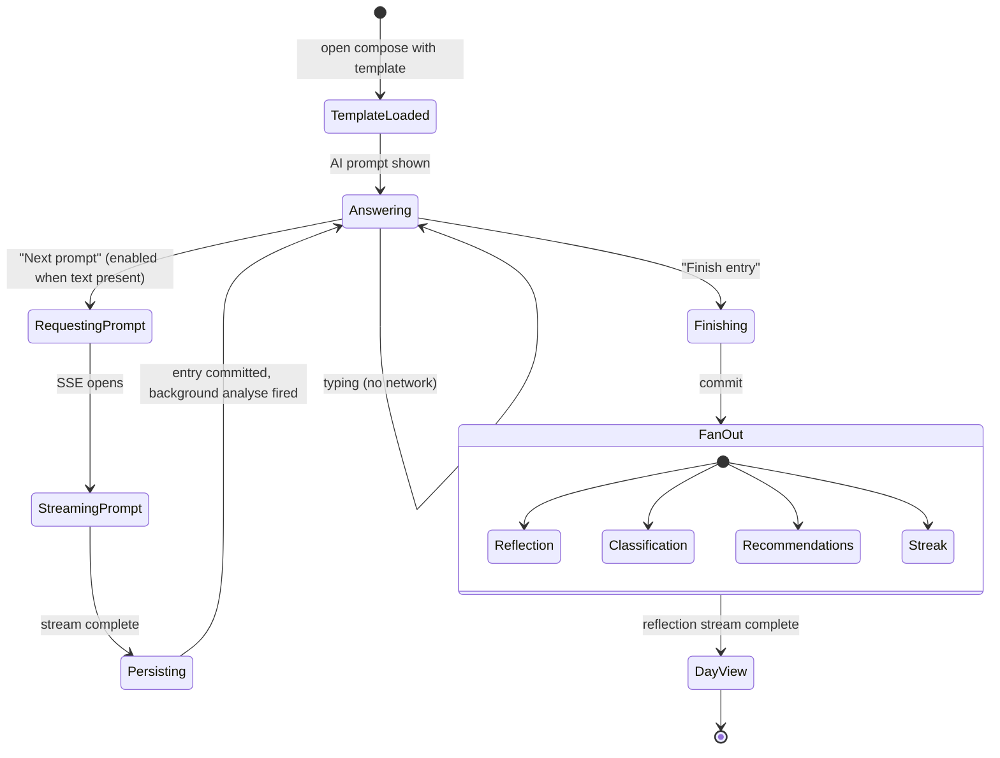
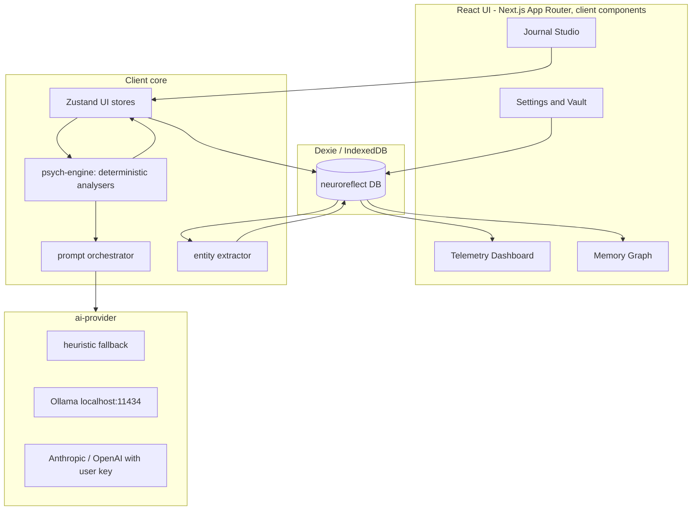
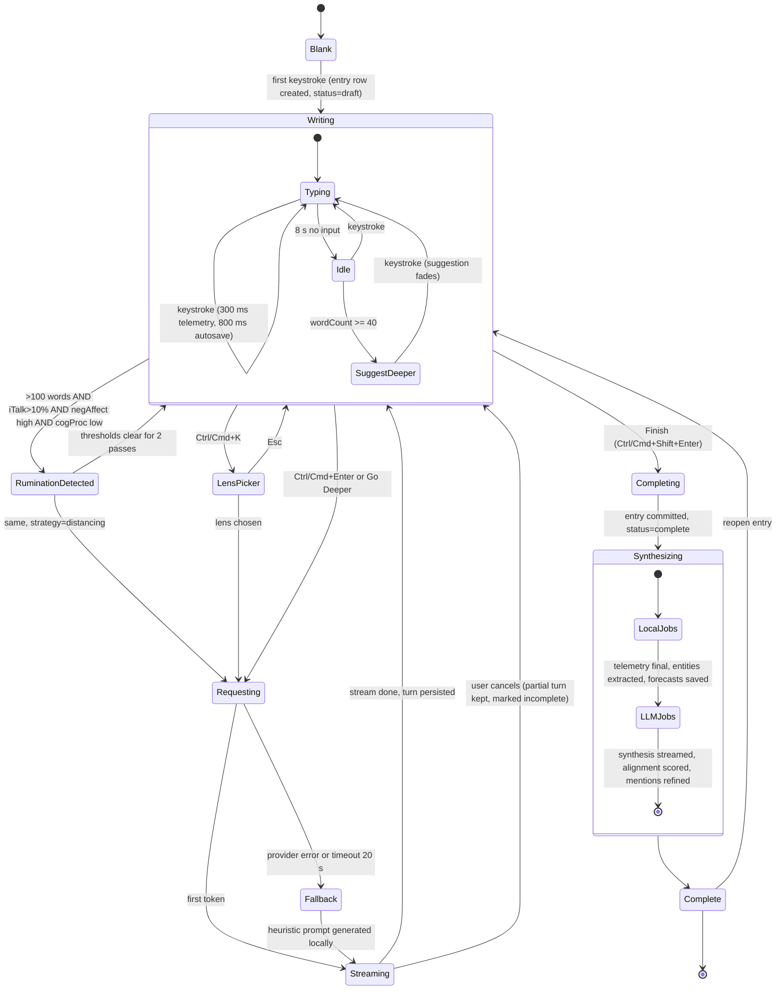
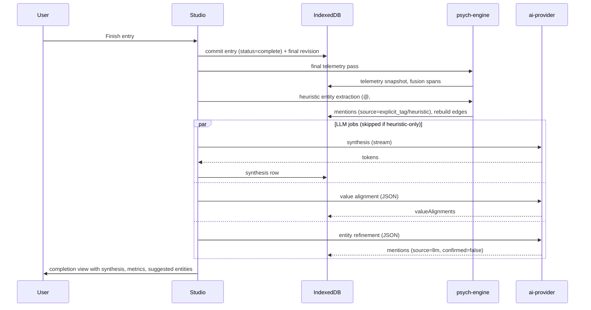

# NeuroReflect - Clean-Room Architecture Specification

Version 0.3 - 18 October 2026. Adds Section 11, which records how the build implemented this design and where it deliberately departs from v0.2 (encryption scope, indexes, stored spans). Version 0.2 added DeepJournal storage and editor findings (Sections 1.4, 2.5).

## 0. How to read this document

This spec has two layers, kept deliberately separate:

- **Observed patterns (Sections 1-4).** Abstract behaviour seen in existing journaling products through passive inspection. Every claim is tagged with its evidence level:
  - **[O]** observed directly (DOM/accessibility tree, storage inventory, network request shapes)
  - **[I]** inferred from observed structure, not confirmed
  - **[N]** not observed; flagged as a gap
- **NeuroReflect design (Sections 5-9).** Original design decisions for our implementation, derived from first principles and the product brief. Where a decision departs from an observed pattern, the reason is given.

### Clean-room boundaries kept during analysis

- Web bundles (A, B, C) were inventoried by file name and size only; no script source was read.
- One exception, corrected in v0.4: rea statically analysed two of D's main-process scripts, `preload.cjs` and `attachment-worker.cjs`. The analysis produced structure counts only (15 API namespaces, about 100 members, about 158 IPC channels). No code was copied, quoted or kept, and no channel or function names were extracted. Earlier versions of this section said no script source was read, which was wrong for D.
- No storage values were read. The inspection tool reports key names with values redacted. D's database file was opened only far enough to read its header, which showed the file is encrypted (Section 1.4).
- Network captures retained **field names and types only**, never values. No prompt text, entry text or AI output was captured or reproduced.
- No authentication, paywall or server control was touched. All traffic was the user's own session in their own browser.
- No branding, copy, styling or assets are carried into the design layer.

### Sources inspected (17-18 Oct 2026)

| Label | Product | Surface | Depth reached |
|---|---|---|---|
| A | Rosebud | Web (Next.js) | Compose screen structure, storage inventory, **full live writing session** with request shapes |
| B | Mindsera | Web (React Router / TipTap) | Onboarding only; module inventory and storage |
| C | Reflection | Web (Flutter WASM) | Home screen; IndexedDB inventory (canvas UI exposed little DOM) |
| D | DeepJournal 0.21.2 | Desktop (Electron 41) | Bundle inventory, preload surface counts, data-folder layout, editor structure during a live session. **Database is encrypted, so no schema; AI traffic runs in the main process and was not observable** |
| - | Hume AI | Web | Emotion-measurement platform, not a journal. Out of scope |

---

## 1. Client storage patterns (observed)

### 1.1 Three distinct storage strategies

| Strategy | Product | Evidence |
|---|---|---|
| **Cloud document DB with offline cache, fronted by persisted UI stores** | A | [O] Firestore offline persistence in IndexedDB; ~10 named persisted stores in localStorage (entry, compose, analyses cache, persona, journey, workspace, metering, playback, ui) |
| **Thin client, server-side journal** | B | [O] No IndexedDB; localStorage holds onboarding progress and analytics only |
| **Per-domain IndexedDB databases** | C | [O] Separate databases for user, settings, prompts, "depth", voice, AI quick actions, and a cached guided-content library (guides, authors, collections, tags) |
| **Local-first desktop with encrypted store** | D | [O] Single encrypted SQLite file in WAL mode, kept in its own data folder separate from the browser-engine profile (Section 1.4). Thick main process behind a large preload bridge |

### 1.2 Entry data model (A, observed via request shapes)

An entry is **not a block of text**. It is an ordered conversation.

```
Entry
  id, day, createdAt, updatedAt, isDraft
  templateId, sourceTemplateId, screenIndex
  activePersonaId
  messageProtocol            # versioned message format
  messages[]                 # ordered turns
    id, pairId               # pairId links an AI prompt to the user answer
    role, type
    content                  # flat text
    createdAt
    inputSources[]           # e.g. typed vs dictated
    personaId, personaType   # on AI turns
    responseMetadata         # model, fallbackUsed
    uiMessage { id, role, parts[] { type, text, state } }   # render form
  relations
    ids[]
    items[] { id, metadata { prompts[], screens[], steps, version, ... } }
```

[O] for all fields above (names and types only).

Key observations:
- **Dual representation per message** [O]: a flat `content` string for analysis plus a structured `uiMessage.parts[]` for rendering. Parts carry a `state`, which supports streaming (partial vs complete).
- **`pairId`** [O] ties each AI prompt to the user's answer, so an entry can be analysed as prompt/response pairs.
- **`inputSources`** [O] records provenance per message, e.g. typed or dictated.
- **`responseMetadata.fallbackUsed`** [O] records when a backup model answered. Model provenance is stored per turn.
- **Templates are data** [O]. A template carries prompts, screens (with options, multiple choice, "other" option, skip and back permissions), step count and a version number.

### 1.3 Extracted entities, affect telemetry, longitudinal snapshots

- [O] A has a client cache for analyses ("analyses" store) and a server endpoint that analyses an entry by ID (Section 3.3).
- [I] Entity extraction and longitudinal memory run **server-side** in A. The per-turn AI request carries only the current entry, not prior entries (Section 3.2).
- [O] B ships "insights", "performance" and wearable-provider modules. Physiological telemetry is joined to journal analytics.
- [O] D's home screen renders a large grid of uniform cells (an activity heatmap) plus a sidebar with search bound to a keyboard shortcut.
- [N] No product exposed a client-side schema for people, themes, mood scores or edit history. This is either server-side or inside D's encrypted database.

### 1.4 Local-first storage layout (D)

- [O] The app's browser-engine profile folder holds only standard engine state (cache, local storage, cookies). **No journal data lives there.**
- [O] Journal data lives in a separate per-user data folder as one SQLite database with write-ahead-log and shared-memory sidecar files (WAL mode), plus a small JSON user cache.
- [O] The database file has **no plaintext SQLite header**: the whole file is encrypted page by page. With the bundled password-hashing library, this is consistent with a key derived from a user secret. [I]
- [N] Schema not read. Inspection stopped at the encrypted header; decrypting would mean getting around a security control, which is outside the clean-room rules.

Takeaways for NeuroReflect:
- Keep journal data out of the browser cache layer's way and make its location explicit, so export, backup and wipe are unambiguous.
- Whole-database encryption hides structure from anyone with the file but means charts need an unlock too. v0.2 proposed encrypting only free-text fields so metrics could render while locked. The build goes further (Section 11): scores such as rumination flags are themselves sensitive, so every field that is not needed for an index is sealed and the whole app sits behind a lock screen. Someone with disk access still sees entry counts, dates and which records link together.

---

## 2. Interaction state machine (observed in A)

### 2.1 Timeline of the live session

All times are seconds from observation start. Typing occupied roughly 0-23 s.

| t (s) | Event | Network |
|---|---|---|
| 0-23 | User types first answer, then pauses ~10 s | **Analytics heartbeat only, every ~5.1 s. No AI request** [O] |
| ~23 | User clicks "Next prompt" | `POST agent` streaming response (`text/event-stream`, ~2.4 KB) [O] |
| ~24-33 | Entry persisted | Document DB write channel plus a batch commit (8 writes) [O] |
| ~24-33 | Background analysis | `POST entry/analyze {entryId}` returns `{success}` immediately [O] |
| ~44 | User clicks "Finish entry" | Batch commit (3 writes) [O] |
| ~45-49 | Completion fan-out | Streak/reward call; a classifier call (`block`); a content-recommendation call (`content`); then `POST entry/reflection` streaming (~7.3 KB) [O] |
| ~49+ | Navigates to the day view | Route changes from compose to today [O] |

### 2.2 Findings

1. **No idle-triggered AI.** [O] A 10-second pause produced no AI call. Prompts come only from an explicit user action. There is no debounce-driven Socratic trigger in this product.
2. **Streaming via Server-Sent Events** [O] for both the next-prompt turn and the final reflection.
3. **Persist first, analyse second.** [O] The entry is committed to the store before the analysis endpoint is called, and the analysis call is fire-and-acknowledge (it returns only a success flag).
4. **Completion is a fan-out of independent jobs** [O]: synthesis, a safety/classification step, content recommendation and gamification each run as separate requests.
5. **UI gating** [O]: "Finish entry" and "Next prompt" stay disabled until the answer box has text.

### 2.3 Observed lifecycle (A)



### 2.4 Gaps

- [N] Debounce timings: none exist in A because nothing fires on idle. B's editor was not observed live; D's AI timing could not be observed (Section 2.5).
- [N] Layout shifts during streaming: the accessibility text capture was disabled during the live run to avoid recording entry content.

### 2.5 Editor structure (D, live session)

Two structural snapshots were taken while the user typed a throwaway entry (text lengths visible, text itself not captured).

- [O] **Block-based rich-text editor** built on a ProseMirror/TipTap engine. Each paragraph is its own block node with a stable per-block ID; pressing Enter created a new block with a new ID.
- [O] A **floating block-side toolbar** (insert-block and drag-handle controls) appears beside the active block, rendered in a portal so it never shifts the text.
- [O] The editor sits under a breadcrumb trail with a header action group; the shell has a collapsible sidebar with search bound to a keyboard shortcut.
- [O] No AI panel or prompt appeared across the snapshots during typing and a pause. Two snapshots cannot rule out an idle trigger, so this is weak evidence only.
- [N] AI request timing and payloads: the renderer sends work to the main process over IPC, and the main process makes any network calls. Page-level inspection cannot see that traffic.

Takeaway: per-block IDs are worth adopting. They give stable anchors for co-pilot turns, fusion highlights and mentions that survive edits, which a single markdown string with character offsets does not (see Section 6 note on `anchorOffset`).

---

## 3. API contract and context assembly (observed in A)

All shapes are field names and types only.

### 3.1 Per-turn prompt request (`agent`)

```
{
  entryId: string,
  entryDay: string,
  localDate: string,              # client local date, not just UTC
  messages: [{ id, role, parts: [{ type, text, state }] }],   # whole entry so far
  model: string,
  personaId: string,
  templateId: string,
  template: {                      # full template inlined, not just an ID
    id, title, type, description,
    metadata: { id, category, hidden, system, prompts: [string], inputs: { entry: number } }
  },
  thinkingEnabled: boolean,
  callModeEnabled: boolean         # voice conversation mode
}
-> text/event-stream
```

**Context assembly findings:**
- [O] The client sends the **entire current entry** each turn. The server holds no conversation state between turns.
- [O] The **template definition is inlined**, so prompt strategy travels with the request.
- [O] **No prior entries or longitudinal summary** are in the per-turn payload. Any long-term memory is added server-side, if at all.
- [O] Mode flags (`thinkingEnabled`, `callModeEnabled`) and persona are per-request switches.

### 3.2 Completion requests

| Endpoint (abstracted) | Request | Response | Purpose [I] |
|---|---|---|---|
| analyze | `{ entryId }` | `{ success }` | Kicks off server-side extraction. Results arrive later via the synced store |
| block (classifier) | `{ type, considerPreviousItems, messages[] }` | `{ response }` | Single-label classification of the conversation, probably safety or routing |
| content | `{ allowedTypes[], entries[] }` (full entry incl. template screens) | `{ message, skip }` | Decides whether to show follow-up content, with an explicit skip |
| reflection | `{ entryId, model, templateId }` | `text/event-stream` | Final synthesis, streamed |
| streak-reward | `{ day, selectionKey }` | `{ frame{...}, fallbackDayUsed }` | Gamification |

[O] for shapes. Purposes are [I].

Notable: the reflection request carries **only IDs**. The server re-reads the entry it just stored, so the expensive synthesis never depends on a client-supplied copy.

---

## 4. Cross-product synthesis

| Concern | Best observed pattern | Weakness we can beat |
|---|---|---|
| Entry structure | Prompt/response pairs with provenance (A) | No free-writing mode with inline AI; the AI only speaks between turns |
| AI trigger | Explicit, user-initiated (A) | No awareness of *how* the user is writing; the AI cannot notice rumination |
| Memory | Server-side extraction after commit (A) | Opaque and cloud-bound; the user cannot inspect or edit what is remembered |
| Privacy | Encrypted local store (D) | Only one product keeps data local |
| Telemetry | Wearable join (B) | Mood is coarse; no linguistic or clinical process measures anywhere |
| Templates | Versioned, data-driven (A, C) | Not tied to psychological frameworks the user can apply on demand |

---

## 5. NeuroReflect architecture (design)

### 5.1 Principles

1. **Local-first, always.** Every entry, metric and graph edge lives in IndexedDB. The only outbound traffic is an AI call the user configured, and the local heuristic engine works with no AI at all.
2. **Deterministic first, LLM second.** Lexical telemetry runs on every keystroke cycle in the browser. The LLM is used for language generation and optional refinement, never for the core numbers on the dashboard.
3. **Persist before analyse** (adopted from A). Never lose text because an AI call failed.
4. **Stateless AI calls** (adopted from A). Each request carries everything it needs, assembled client-side, so any provider (cloud or Ollama) is interchangeable.
5. **Transparent memory.** Anything the system "remembers" is a visible, editable row.

### 5.2 Layers



Next.js serves a static client app (`output: 'export'` compatible). No API routes touch journal data. Cloud AI calls go **directly from the browser** to the provider with the user's key, so no NeuroReflect server ever sees an entry.

---

## 6. Data model (design)

### 6.1 Entity-relationship schema

```mermaid
erDiagram
    ENTRY ||--o{ ENTRY_REVISION : "has history"
    ENTRY ||--o{ COPILOT_TURN : "contains"
    ENTRY ||--|| TELEMETRY_SNAPSHOT : "scored by"
    ENTRY ||--o| SYNTHESIS : "distilled into"
    ENTRY ||--o{ MENTION : "mentions"
    ENTRY ||--o{ FUSION_SPAN : "flags"
    ENTRY ||--o{ FORECAST : "logs"
    NODE ||--o{ MENTION : "is mentioned in"
    NODE ||--o{ EDGE : "source"
    NODE ||--o{ EDGE : "target"
    CORE_VALUE ||--o| NODE : "projected as"
    ENTRY ||--o{ VALUE_ALIGNMENT : "rated against"
    CORE_VALUE ||--o{ VALUE_ALIGNMENT : "rates"

    ENTRY {
        string id PK
        string createdAt
        string updatedAt
        string localDay
        string status "draft | complete"
        string markdown
        int wordCount
        int activeSeconds
        string inputSources "typed, dictated"
    }
    ENTRY_REVISION {
        string id PK
        string entryId FK
        string at
        string markdown
        int wordCount
    }
    COPILOT_TURN {
        string id PK
        string entryId FK
        string pairId
        string mode "socratic | lens | synthesis | distancing"
        string lens "stoic | first_principles | cbt | act | null"
        string role "assistant | user"
        string text
        int anchorOffset "char offset in entry when asked"
        string provider
        string model
        bool fallbackUsed
        string createdAt
    }
    TELEMETRY_SNAPSHOT {
        string entryId PK
        float iTalkDensity
        float negAffectDensity
        float posAffectDensity
        float cogProcDensity
        int fusionScore "0-100, 100 = fully defused"
        float avoidanceDensity
        float granularityIndex "unique fine labels per 1000 words"
        int coarseLabelCount
        bool ruminationFlag
        string computedAt
        string engineVersion
    }
    SYNTHESIS {
        string entryId PK
        string keyTakeaway
        string hiddenAssumption
        string microAction
        string provider
        string createdAt
    }
    NODE {
        string id PK
        string kind "person | theme | value | distortion | pattern"
        string label
        string normalised
        string firstSeen
        string lastSeen
        int mentionCount
    }
    MENTION {
        string id PK
        string entryId FK
        string nodeId FK
        int start
        int end
        string source "explicit_tag | heuristic | llm"
        bool confirmed
    }
    EDGE {
        string id PK
        string sourceId FK
        string targetId FK
        string kind "co_occurs | evokes | conflicts"
        float weight
        string lastEntryId
    }
    FUSION_SPAN {
        string id PK
        string entryId FK
        int start
        int end
        string pattern "absolutist | overgeneralise | catastrophise | mind_read"
        string suggestedReframe
    }
    FORECAST {
        string id PK
        string entryId FK
        string eventName
        string targetDate
        int predictedDread
        int predictedCoping
        string worstCase
        int actualImpact "null until calibrated"
        int actualCoping
        string calibratedAt
    }
    CORE_VALUE {
        string id PK
        string label
        string description
        int order
    }
    VALUE_ALIGNMENT {
        string id PK
        string entryId FK
        string valueId FK
        int score "-2 drift to +2 aligned"
        string evidence
    }
```



### 6.2 Dexie declaration (stores and indexes)

As built (schema version 2). Section 11 lists the differences from v0.2.

```
entries:           id, localDay, status, updatedAt
entryRevisions:    id, entryId, at
copilotTurns:      id, entryId, [entryId+createdAt]
telemetry:         entryId, localDay, computedAt
syntheses:         entryId
nodes:             id, kind, lastSeen
mentions:          id, entryId, nodeId
edges:             id, sourceId, targetId
forecasts:         id, entryId, targetDate, calibratedAt
coreValues:        id, order
valueAlignments:   id, entryId, valueId
settings:          key
promptTemplates:   id            (the person's edits only)
```

Design notes:
- **Decided: block IDs, not character offsets.** Entries are stored as blocks with stable IDs; anchors are `{blockId, offset}` and mentions carry `blockId` plus offsets within that block, so editing earlier text never moves them. Plain text is derived for analysis and export.
- **No personal text in any index.** Indexed fields stay readable when the passphrase lock is on, so names are matched in memory rather than through an index (v0.2 indexed `nodes.normalised`).
- **Revisions** are written on a coarse cadence (every 60 s of active editing and on completion), not per keystroke. This gives edit history without bloating storage.
- **`mentions.source` and `confirmed`** make extraction transparent. Heuristic and LLM extractions show as suggestions until the user confirms or removes them, which keeps the graph honest.
- **Graph edges are derived data.** They can be rebuilt from mentions at any time, so a bad extraction never corrupts history.
- **`engineVersion`** on telemetry lets the dashboard recompute when the lexicons change, rather than mixing scores from different versions.
- **Encryption at rest** (adopted in spirit from D): optional passphrase lock. The key is derived with PBKDF2-SHA256 (600,000 iterations, OWASP's current figure) through WebCrypto and held only in memory. Every non-indexed field of a record is sealed into one envelope with XSalsa20-Poly1305 (TweetNaCl). Section 11 explains why this differs from the AES-GCM, text-only plan in v0.2.

---

## 7. Interaction state machine (design)

### 7.1 Departure from observed behaviour

A never fires AI on idle. NeuroReflect keeps the **user in control** but adds **local awareness**:

- Deterministic telemetry recomputes continuously (cheap, local, private).
- The co-pilot **suggests** rather than interrupts. A soft "Go deeper" affordance appears after an idle pause. An AI call happens only on click or `Ctrl/Cmd+Enter`.
- The one exception is the rumination circuit-breaker, which changes the **strategy** of the next prompt and shows a visible banner. It still does not send anything by itself.

This keeps the one observed behaviour (no unsolicited AI calls) while making the co-pilot responsive to how the person is writing. Only one product was observed live, so "the market avoids idle triggers" is not established.

### 7.2 Timings

| Timer | Value | Purpose |
|---|---|---|
| Telemetry debounce | 300 ms after last keystroke | Recompute lexical metrics |
| Autosave debounce | 800 ms | Persist entry to IndexedDB |
| Revision cadence | 60 s active editing | Write an `entryRevision` |
| Idle threshold | 8 s no input, min 40 words | Reveal "Go deeper" suggestion |
| Rumination evaluation | Every telemetry pass once > 100 words | Enter or leave rumination state |
| Rumination hysteresis | Must stay below thresholds for 2 passes to clear | Prevent flicker |
| Session timer | Counts active seconds only (pauses after 30 s idle) | Honest session length |

These are design values to tune in testing, not observed values.

### 7.3 Editor and co-pilot lifecycle



### 7.4 Layout behaviour

- The co-pilot pane is a fixed-width right drawer (collapsible to a 48 px rail). Opening it **never reflows the editor column width**. The editor is centred in its own column with a max measure, so a streaming response cannot shift the text the user is reading.
- Streaming text renders into a reserved block with `min-height` set to the last response height, which avoids jumping as tokens arrive.
- The rumination banner slides into the bottom telemetry bar, not above the editor, so it does not displace the writing.
- Fusion highlights are decorations (underline only), so they never change line height or wrap.

---

## 8. AI provider contract and context assembly (design)

### 8.1 Provider interface

```
interface AIProvider {
  id: 'heuristic' | 'ollama' | 'anthropic' | 'openai'
  available(): Promise<boolean>
  stream(req: CoPilotRequest, signal: AbortSignal): AsyncIterable<string>
  complete(req: StructuredRequest): Promise<unknown>   # JSON-mode jobs
}
```

Resolution order is user-configured, with `heuristic` always last so every feature works offline.

### 8.2 Request assembly

Stateless, as observed in A, but with longitudinal context assembled **locally** because there is no server to add it.

```
CoPilotRequest {
  mode: 'socratic' | 'lens' | 'synthesis' | 'distancing'
  lens?: 'stoic' | 'first_principles' | 'cbt' | 'act'
  entry: {
    text: string            # trimmed to last ~1,500 words if longer
    localDate: string
    wordCount: number
  }
  turns: [{ role, text }]   # this entry's co-pilot turns only
  telemetry: {              # the deterministic signals, as numbers
    iTalkDensity, negAffectDensity, cogProcDensity,
    fusionScore, granularityIndex, ruminationFlag,
    coarseLabels: string[]  # e.g. ["stressed","fine"]
  }
  memoryBrief: {            # compact, user-visible, max ~300 tokens
    recurringThemes: [{ label, count, lastSeen }]   # top 5
    people: [{ label, count }]                      # top 5 mentioned this entry or last 14 days
    coreValues: string[]
    openForecasts: [{ eventName, targetDate }]
  }
  userName?: string         # for third-person distancing prompts
}
```

Design notes:
- **The memory brief is built from rows the user can see** in the graph and settings. Nothing hidden is sent.
- **Telemetry travels with the request**, so the LLM's question is grounded in the deterministic analysis rather than re-guessing it.
- **One question per Socratic turn** is enforced in the system template and checked on return (if the response contains more than one question mark-terminated sentence, keep the first).
- **Synthesis is a structured job** returning `{ keyTakeaway, hiddenAssumption, microAction }`. If parsing fails, the heuristic fallback produces a template-based distillation from telemetry and extracted entities.
- **System templates are stored in `promptTemplates`** and shown read-only in Settings, as the brief requires. They are written from scratch for NeuroReflect.

### 8.3 Completion pipeline

Adopts A's "persist first, then fan out", with each job independent so one failure does not block others:



---

## 9. Psychological engines: data contracts (design)

Formulae are specified here so the dashboard is reproducible. Lexicons are original word lists to be authored for NeuroReflect; published LIWC dictionaries are proprietary and must not be copied.

| Engine | Metric | Definition |
|---|---|---|
| A | I-talk density | count(I, me, my, mine, myself) / total words |
| A | Negative / positive affect density | lexicon hits / total words |
| A | Cognitive processing density | hits on causal and insight markers / total words |
| A | Rumination flag | words > 100 AND iTalk > 0.10 AND negAffect > 0.03 AND cogProc < 0.025 (defaults calibrated on the sample entries; tunable in Settings) |
| B | Fusion score | 100 - clamp(fusedHits x 12 - defusedHits x 15, 0, 100), where fused = absolutist and overgeneral patterns, defused = metacognitive frames ("I notice", "the thought that") |
| B | Experiential avoidance | density of avoidance verbs and suppression phrases |
| B | Values alignment | LLM rating -2 to +2 per core value with quoted evidence; heuristic fallback uses value keyword co-occurrence with approach vs avoidance verbs |
| C | Granularity index | distinct fine-grained emotion concepts per 1,000 words; coarse labels counted separately for the scaffolder |
| D | Prediction error | Delta = predictedDread - actualImpact, plotted per forecast with a rolling mean |

The rumination thresholds for negative affect and cognitive processing are not in the brief. The defaults above were calibrated so that, of the four sample entries, only the high-rumination one trips the breaker. They are a starting point, not a validated cut-off, and should be checked against real writing before relying on them.

---

## 10. Open gaps and recommended next steps

| Gap | Impact | How to close |
|---|---|---|
| D AI timing and payloads | Unknown whether a local-first competitor triggers AI on idle | Not closable with page inspection (main-process traffic). Would need a provider-run capture, which relaunches the app. Low value: the design does not depend on it |
| D database schema | Closest local-first data model unknown | **Closed as far as allowed**: file is fully encrypted; stopped at the header (Section 1.4) |
| B editor not observed | No data on inline AI in a rich-text editor | Finish Mindsera onboarding and repeat the live capture |
| Streaming layout shifts not captured | Section 7.4 is design-only | Repeat A's live run with screenshots after each step |
| Rumination thresholds | Engine A may over- or under-fire | **Calibrated on the sample entries** (Section 9); still needs checking against real writing |

None of these blocked the build.

---

## 11. Implementation notes (as built)

### 11.1 Departures from v0.2

| Area | v0.2 design | As built | Why |
|---|---|---|---|
| Encryption scope | Free-text fields only; metrics readable so charts render while locked | Every field not used by a key or index is sealed; the app shows a lock screen until unlocked | Scores and flags (for example "rumination loop on 13 Oct") are sensitive in their own right. Only IDs, dates, status, node kinds, value order and link structure stay readable |
| Cipher | AES-GCM via WebCrypto | XSalsa20-Poly1305 via TweetNaCl (audited by Cure53 in 2017); key still from PBKDF2-SHA256 via WebCrypto | IndexedDB transactions close as soon as code waits on anything else, so the asynchronous WebCrypto cipher cannot run inside them. The synchronous cipher runs inside a Dexie middleware, which keeps every read and write path unchanged. Its 192-bit nonces are safe to choose at random |
| Integrity binding | Not specified | Each sealed payload names its table and primary key; an envelope copied onto another record fails to open | Stops records being swapped by someone who can write to the profile |
| Name index | `nodes.normalised` and `[kind+normalised]` indexed | Removed (schema v2); names matched in memory | Indexed values cannot be encrypted |
| Fusion spans | `fusionSpans` store | Computed live from the text | Spans are cheap to recompute and would go stale on every edit |
| Prompt templates | Stored copies of the built-in prompts | Built-in prompts live in code; the store holds only the person's edits. A fixed shared preamble (safety line, style rules) is always sent first | Edits survive upgrades, and no edit can remove the safety line |
| Timeline Explorer | Not specified in detail | Second mode of the Memory view: one lane per person, theme, value and thinking pattern over time, entry and forecast lanes, hover details, lane filtering and text search | Answers "when did this show up, and what else was going on" |

### 11.2 Lock behaviour

- Off by default. Turning it on re-writes every record sealed in one transaction, so a closed tab mid-way leaves the journal as it was.
- Auto-lock after 5, 15 (default), 30 or 60 minutes without input, or never. Alt+L or the sidebar locks at once. Unsaved text and any prompt mid-stream are saved first.
- Only one tab is unlocked at a time; unlocking one locks the others. A record written plain by a tab that had not yet noticed the lock is sealed at the next unlock.
- A forgotten passphrase cannot be recovered. The lock screen offers to erase the journal so an export can be imported.
- Exports are always decrypted records, either readable or AES-256-GCM encrypted with their own passphrase. The lock's metadata never leaves the device, and importing keeps the device's lock.

### 11.3 Verification

| Suite | Runs in | Checks |
|---|---|---|
| Engine (`tests/engine.test.ts`) | Node | 18: thresholds on the samples, fusion and defusion, coarse labels, values scoring, entity extraction, heuristic co-pilot |
| Storage (`tests/storage.test.ts`) | Node with fake-indexeddb | 14: v1 to v2 upgrade, nothing personal stored readable once locked, identical read-back, update and modify paths, stragglers, integrity binding, passphrase change, export and import, erase, turning the lock off, graph maintenance |
| Main flows (`tests/e2e.mjs`) | Chromium | 43, including live rumination detection, timeline, graph, exports, zero console errors |
| Lock (`tests/lock.e2e.mjs`) | Chromium | 24, including raw IndexedDB inspection, wrong passphrase, auto-lock, two tabs, erase |
| Providers (`tests/providers.e2e.mjs`) | Chromium with mocked endpoints | 18: Anthropic, OpenAI and Ollama request shapes and streaming parsers, edited templates reaching the request, fallback on failure |

The provider adapters were tested against mocks that follow each API's documented streaming format. They have not been run against the live services.
